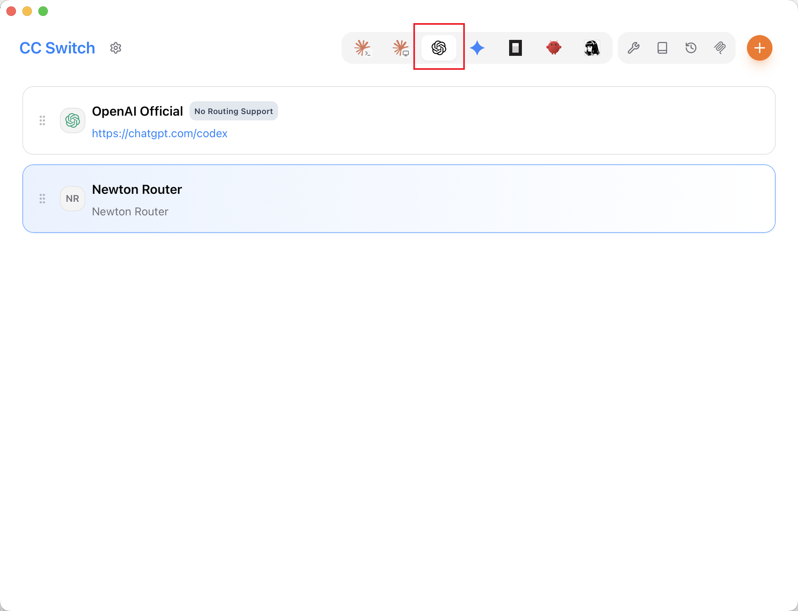
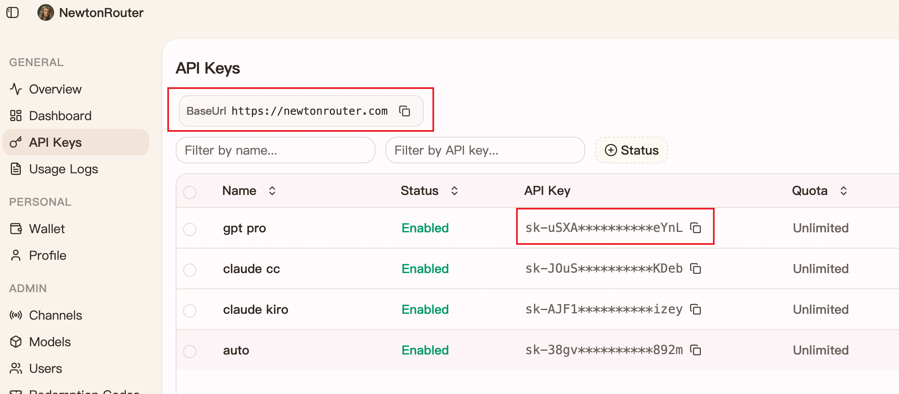
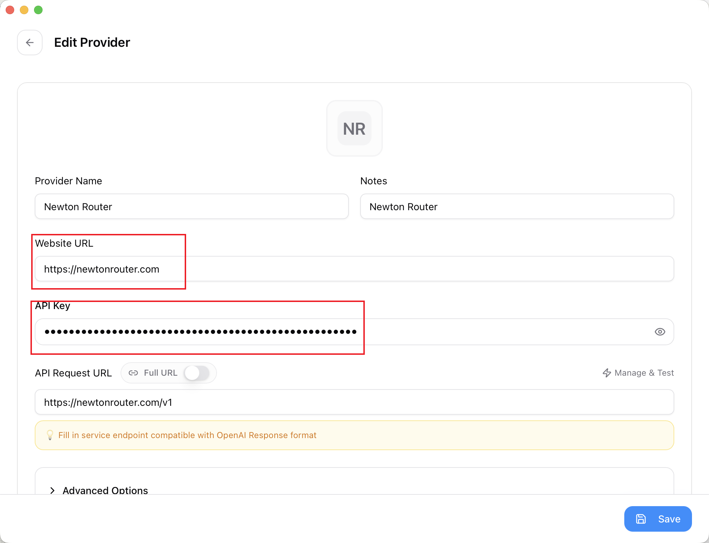
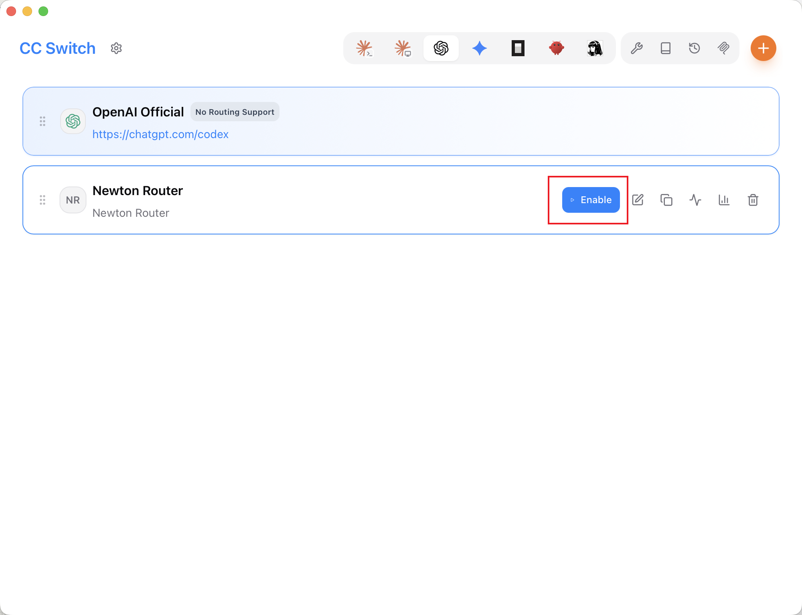

# CC Switch Setup

CC Switch provides one-click API profile switching, visual configuration management, built-in Right Code templates, MCP server management, system tray shortcuts, a local proxy with hot switching between providers such as CC, CX, and Gemini, and automatic failover.

## Download

[CC Switch Releases](https://github.com/farion1231/cc-switch/releases)

## Configuration

- Select the model tool you want to configure. This example uses **Open AI**; the process is the same for other tools.

- Select **Codex**, then select **Custom configuration**.

- Enter the **API key**, **Base URL**, and other parameters, then select **Add**.

- Enable the new configuration on the main screen.

