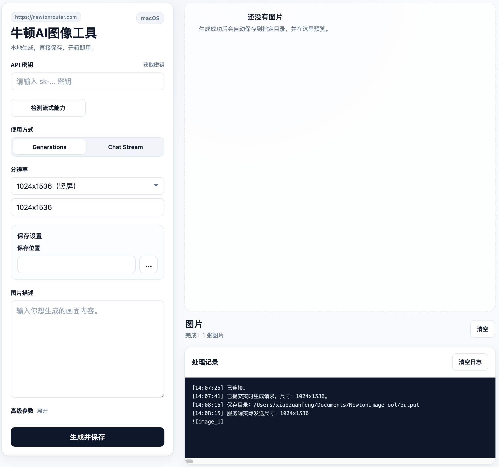

<font style="color:rgb(26, 28, 31);">gpt-image-2</font><font style="color:rgb(26, 28, 31);"> 是一个用于根据文字提示生成高质量图片的图像生成模型，适合海报、插画、产品图和创意视觉内容生成</font>

## <font style="color:rgb(24, 24, 27);background-color:rgb(250, 250, 250);">Curl使用</font>
```plain
curl -m 300 -X POST "https://newtonrouter.com/openai/v1/images/generations" \
  -H "Authorization: Bearer your-api-key" \
  -H "Content-Type: application/json" \
  -d '{"model":"gpt-image-2","prompt":"a cat","size":"1024x1024","quality":"low"}'
```

## <font style="color:rgb(24, 24, 27);background-color:rgb(250, 250, 250);">使用可视化工具</font>
### 国内下载地址：
[夸克网盘分享](https://pan.quark.cn/s/d5919430fb71)

###   
GitHub：
[https://github.com/Aunt-Lee/newton-image-tool/releases/tag/v1.0.0](https://github.com/Aunt-Lee/newton-image-tool/releases/tag/v1.0.0)


### <font style="color:rgb(39, 39, 42);background-color:rgb(250, 250, 250);">使用说明</font><font style="color:rgb(82, 82, 91);">：</font>



+ 在API密钥填入在本站获取的密钥，[牛顿AI中转站](https://newtonrouter.com)；
+ 使用方式默认第一种，无法生成时可尝试第二种；
+ 分辨率默认1K，分辨率越高生成时间越久；
+ 在图片描述中填写想要生成的图片
