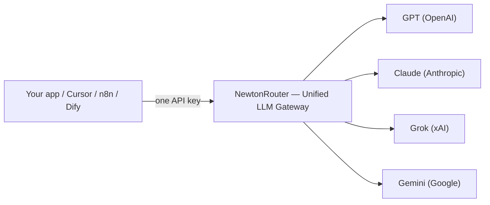

<!-- JSON-LD: Article + BreadcrumbList + FAQPage -->
<script type="application/ld+json">
{
  "@context": "https://schema.org",
  "@graph": [
    {
      "@type": "Article",
      "headline": "OpenRouter Alternatives: 10+ LLM API Gateways Compared (2026)",
      "description": "Stripe acquired OpenRouter in 2026. Compare 10+ LLM API gateways on price, privacy & zero-retention. Pick a top OpenRouter alternative and migrate in minutes.",
      "author": { "@type": "Organization", "name": "NewtonRouter Team" },
      "publisher": {
        "@type": "Organization",
        "name": "NewtonRouter",
        "logo": { "@type": "ImageObject", "url": "https://newtonrouter.com/logo.png" }
      },
      "datePublished": "2026-11-10",
      "dateModified": "2026-11-10",
      "mainEntityOfPage": { "@type": "WebPage", "@id": "https://newtonrouter.com/blog/openrouter-alternatives" }
    },
    {
      "@type": "BreadcrumbList",
      "itemListElement": [
        { "@type": "ListItem", "position": 1, "name": "Blog", "item": "https://newtonrouter.com/blog" },
        { "@type": "ListItem", "position": 2, "name": "OpenRouter Alternatives", "item": "https://newtonrouter.com/blog/openrouter-alternatives" }
      ]
    },
    {
      "@type": "FAQPage",
      "mainEntity": [
        {
          "@type": "Question",
          "name": "What is the cheapest OpenRouter alternative?",
          "acceptedAnswer": {
            "@type": "Answer",
            "text": "Going direct to a provider is technically cheapest, with no platform fee at all. Among gateways, reseller-aggregators price below official list on many models: APIVAI claims 56-86% savings, Crouter advertises ~75% off, and KissAPI offers 5x top-up credit. NewtonRouter offers a $1 first top-up for $5 credit and a seven-language interface. The biggest saving usually comes from picking a cheaper provider for the same open model, not from a fee alone. Validate on your real prompts."
          }
        },
        {
          "@type": "Question",
          "name": "Does OpenRouter mark up token prices?",
          "acceptedAnswer": {
            "@type": "Answer",
            "text": "No. OpenRouter charges no markup on token prices; its per-token rates match each provider's list price. It earns a 5.5% fee (Standard plan) on credit-card purchases (5% on crypto, $0.80 minimum) and a 5% fee on BYOK traffic above a $25,000 monthly free allowance. Going direct is therefore at least 5.5% cheaper on the same usage, before any aggregator discount."
          }
        },
        {
          "@type": "Question",
          "name": "Is migrating off OpenRouter hard?",
          "acceptedAnswer": {
            "@type": "Answer",
            "text": "Usually minutes. Every gateway here exposes an OpenAI-compatible endpoint, so the change is a base URL and API key swap, plus occasionally a model-name prefix. The real work is recreating your provider preferences, spend limits, and fallback rules, not the code change."
          }
        },
        {
          "@type": "Question",
          "name": "Which OpenRouter alternative supports the most languages?",
          "acceptedAnswer": {
            "@type": "Answer",
            "text": "NewtonRouter leads with a seven-language interface: Simplified Chinese, Traditional Chinese, English, French, Japanese, Russian, and Vietnamese. APIVAI offers five (English, Russian, Chinese, Spanish, Portuguese). Most other gateways are English-only."
          }
        },
        {
          "@type": "Question",
          "name": "What is the best OpenRouter alternative for privacy and zero retention?",
          "acceptedAnswer": {
            "@type": "Answer",
            "text": "Look for explicit zero-retention architecture and regional controls. OpenRouter offers ZDR routing and EU locking but no HIPAA. Requesty lets you pin zero-retention endpoints with EU residency. NewtonRouter builds zero retention into its core logging: prompts and completions are not stored. For the strictest postures, a self-hosted option like LiteLLM keeps all traffic inside your own network."
          }
        },
        {
          "@type": "Question",
          "name": "Is there an open-source OpenRouter alternative?",
          "acceptedAnswer": {
            "@type": "Answer",
            "text": "Yes. LiteLLM is the most widely adopted, a free, open-source Python proxy to 100+ providers. Bifrost (Go) and Kong AI Gateway are alternatives if you already run those stacks. Self-hosting removes the platform fee but adds operational ownership: databases, patching, and uptime."
          }
        }
      ]
    }
  ]
}
</script>

# OpenRouter Alternatives: 10+ LLM API Gateways Compared (2026)

*By NewtonRouter Team · Published November 10, 2026 · Last verified November 10, 2026*

On August 19, 2026, [Stripe announced it would acquire OpenRouter](https://stripe.com/jp/newsroom/news/stripe-agrees-to-acquire-openrouter), the gateway routing 600+ AI models for more than 10 million developers. If you are now searching for an **OpenRouter alternative**, you are in good company. The deal set off a wave of "OpenRouter migration" queries as teams re-examine where their AI traffic, keys, and invoices live.

But migration anxiety is only half the story. For over a year, developers have complained about a failure mode no dashboard shows: **silent model degradation**. A request tagged for a flagship model gets quietly served by a cheaper stand-in, response quality dips, and nobody can prove it happened. That trust gap is the real reason many teams go shopping for an OpenRouter replacement.

This guide compares 10+ gateways side by side so you can pick on evidence instead of fear. We cover what an LLM gateway actually does, the five questions that decide whether you need one, a full set of comparison tables, and how to migrate in minutes.

> **Key Takeaways**
> - An **LLM API gateway** collapses many provider SDKs, keys, and bills into one OpenAI-compatible endpoint. Most migrations are just a base-URL swap.
> - OpenRouter remains the catalog leader (600+ models, 80+ providers on Standard) but charges a [5.5% Standard-plan fee on credit purchases](https://openrouter.ai/pricing) and offers no self-hosting or HIPAA coverage.
> - The strongest **OpenRouter alternatives** split into two camps: open-source self-hosted (LiteLLM) and managed aggregators (NewtonRouter, Requesty, NanoGPT, Crouter, KissAPI, APIVAI, Atlas).
> - **Stability, privacy, and price** are the new battlegrounds: look for no-silent-degradation routing, zero-retention logging, and rates well below official list if cost is your priority.
> - **NewtonRouter bundles all three**: a 7-language UI, zero-retention architecture, and no silent degradation. Worth a look against the incumbents.

### In this guide
- [What Is an LLM API Gateway?](#what-is-an-llm-api-gateway)
- [Do You Actually Need a Gateway?](#do-you-actually-need-a-gateway)
- [The 10+ Best OpenRouter Alternatives in 2026](#the-10-best-openrouter-alternatives-in-2026)
- [How to Choose the Right OpenRouter Alternative](#how-to-choose-the-right-openrouter-alternative)
- [Migration & Getting Started: It's a Base URL Swap](#migration-getting-started-its-a-base-url-swap)
- [Three Stories That Explain the Shift](#three-stories-that-explain-the-shift)
- [Red Flags to Watch](#red-flags-to-watch)
- [FAQ](#faq)
- [Conclusion](#conclusion-pick-on-evidence-migrate-in-minutes)

## What Is an LLM API Gateway?

If you are weighing an OpenRouter alternative, start here. An LLM API gateway is a proxy layer that sits between your application and every model provider you use. Instead of wiring separate clients, keys, rate limits, and billing for OpenAI, Anthropic, Google, and xAI, your code talks to one API. You pick a model by name, and the gateway translates the request to the right provider behind the scenes.

Think of it as a universal adapter for AI. The interface is almost always [OpenAI-compatible](https://newtonrouter.com/blog/openai-compatible-api-explained), which matters more than any headline model count. If your existing code already uses the OpenAI SDK, you change two lines (the `base_url` and the `api_key`) and suddenly GPT, Claude, Gemini, and Grok all answer through one key.

A mature gateway does four jobs:

- **Unified API access.** One key, one request shape, hundreds of models. Switch from `gpt-5` to `claude-opus` by changing a string.
- **Failover and routing.** When a provider times out or returns an error, traffic moves to a backup model automatically. Good gateways log which model actually served the request.
- **Cost tracking.** Per-key, per-team, per-customer spend attribution in one dashboard instead of five provider consoles.
- **Observability.** Latency, token counts, success rates, and fallback events recorded in one place.

The best OpenRouter alternatives keep this surface identical so your SDK, your Cursor setup, and your n8n workflows never know the backend changed.



## Do You Actually Need a Gateway?

Not every project should add a hop. A gateway earns its place the moment you cross a few thresholds.

You need an LLM API gateway if you use more than one model provider, require automatic failover, want a single consolidated invoice, handle regulated or sensitive data, or run agents and automation. Answer "yes" to two or more and a gateway pays for itself.

Ask yourself five questions:

1. **Are you using more than one provider?** If you run only OpenAI, direct integration is simpler and faster. The moment you add a second model for redundancy or cost, a gateway starts paying for itself.
2. **Do you need automatic failover?** If a provider outage takes your app down today, a gateway's fallback chain is the cheapest insurance you can buy.
3. **Do you want one invoice instead of five?** Finance teams hate reconciling separate provider dashboards. A gateway consolidates spend.
4. **Do you handle sensitive or regulated data?** Then you need a gateway (or self-hosted proxy) that supports zero-retention routing and region locking.
5. **Do you run agents or automation?** Agent loops burn tokens in tight circles. Per-key budgets and routing policy stop a runaway loop from becoming a surprise invoice.

If you answered "yes" to two or more, a gateway is worth it. If you are prototyping on a single model at low volume, stay direct and revisit this in a quarter.

Before you compare vendors, **[View per-token pricing →](https://newtonrouter.com/pricing)** to see what each plan covers.

For a deeper look, [compare OpenRouter alternatives](llm-api-pricing-comparison-2026.md) across providers and models.

## The 10+ Best OpenRouter Alternatives in 2026

Below is the head-to-head, split into two narrow tables so every column stays readable on a phone — no horizontal scrolling. We ranked on the dimensions that actually change your life: pricing, model breadth, stability, privacy, and language support. *Last verified: 2026-11-10.*

### At a glance: price, coverage and fit

| Gateway | Pricing | Model coverage | Best for |
|---|---|---|---|
| **OpenRouter** | 5.5% fee (Standard) on credit buys; provider list price | 600+ / 80+ | Broadest catalog, zero ops |
| **NewtonRouter** | First top-up: $1 for $5 credit | GPT / Claude / Grok / Gemini | Multi-lang teams, stability, privacy, low cost |
| **[LiteLLM](https://github.com/BerriAI/litellm)** | OSS free; Enterprise paid | 100+ providers | Self-hosting, max control |
| **Portkey** | $49/mo + $9 per 100k logs | 1600+ / 250+ | Compliance, enterprise |
| **Requesty** | 5% markup on model cost (0% BYOK) | 600+ / 30+ | Production, EU sovereignty |
| **Crouter** | Pay-per-token, ~75% off official, no free tier | Claude / GPT / Gemini | Coding agents |
| **NanoGPT** | No markup on text; $12/mo PRO | 634 text + multimodal | Multimodal, anonymous use |
| **APIVAI** | Pay-as-you-go; ~56–86% off; min $10 | 20 (12 Claude, 8 GPT) | Cost-focused Claude/GPT |
| **KissAPI** | 5× top-up ($5→$25 and up); free $1 trial | Claude, GPT-5, Gemini | Global devs, no VPN |
| **Atlas** | Aggregator, card; multimodal focus | Image / video heavy | Multimodal media |

### Under the hood: stability, privacy and deployment

| Gateway | Deployment | Stability / no downgrade | Privacy / retention |
|---|---|---|---|
| **OpenRouter** | Managed | Fallback to next model | SOC 2, GDPR, ZDR routing, EU lock; no HIPAA or on-prem |
| **NewtonRouter** | Managed | First-tier channels, no silent degradation | Zero retention |
| **LiteLLM** | Self-hosted (OSS) | You own it | You control it |
| **Portkey** | Managed + OSS core (MIT) | Governance, guardrails | HIPAA, SOC 2, ISO 27001, PII redaction |
| **Requesty** | Managed | Failover in under 20ms | ZDR pinnable, EU residency, SOC 2 Type I |
| **Crouter** | Managed | Auto failover across channels | Not emphasized |
| **NanoGPT** | Managed | Auto-routing, fallback | Accounts optional, local history |
| **APIVAI** | Managed | Multi-channel | No body logging |
| **KissAPI** | Managed | Multi-channel failover; 99.5% uptime | Not emphasized |
| **Atlas** | Managed | Not emphasized | Not emphasized |

**Compatibility and UI languages.** Every gateway in the two tables above speaks the OpenAI-compatible API — usually a base-URL swap is all you need. Crouter, NanoGPT and APIVAI also accept Anthropic-native requests, and NanoGPT supports the Responses API. On the dashboard, only NewtonRouter (7 languages) and APIVAI (5) ship localized UIs; the rest are English-only, and Atlas does not state its UI language.

### OpenRouter — the incumbent, judged fairly

OpenRouter earned its category lead. One key reaches 600+ models across 80+ providers, with zero infrastructure to manage and automatic fallback when a model degrades. Inference passes through at each provider's list price. [OpenRouter](https://openrouter.ai/pricing) makes its money on a 5.5% fee (Standard plan) when you buy credits (5% on crypto, $0.80 minimum), plus 5% on bring-your-own-key traffic above a free monthly allowance. It is SOC 2 compliant, GDPR compatible, and offers zero-data-retention routing with EU region locking.

The trade-offs are structural, not moral. There is no [self-hosting option](https://newtonrouter.com/blog/self-hosted-vs-managed) (a compliance blocker for some), no HIPAA coverage, and the 5.5% (Standard) fee is real money at scale. If you are prototyping, it is hard to beat. If you need in-VPC deployment, production governance, or you simply object to the fee, the alternatives below get interesting.

### Why consider NewtonRouter

NewtonRouter is a managed, OpenAI-compatible gateway built on one promise: the model you ask for is the model that answers. Point any OpenAI-compatible client at `https://newtonrouter.com/v1` with a single key: ChatGPT-class apps, Cursor, Claude Code, Cline, n8n, Dify, LangChain, or your own bot. It then reaches GPT, Claude, Grok, and Gemini through a single interface. The full [model catalog](https://newtonrouter.com/models) shows every model and its live rate.

Its defensible differentiators:

- **Honest model access.** Many resellers promise bigger discounts but quietly swap in a cheaper model to hit the price. NewtonRouter's first-tier channels mean you get the exact model you asked for; its rates come from volume negotiation with providers, not from cutting corners on quality.
- **No silent downgrades.** Traffic runs through first-tier channels. Some aggregators quietly swap in a cheaper model and still bill it as the flagship. Or so their customers allege. NewtonRouter doesn't. Ask for Claude, you get Claude.
- **Zero retention.** It stores neither your prompts nor your completions. Among managed gateways that is unusual, and it matters for healthcare, finance, and HR workloads. See how [zero-retention logging](https://newtonrouter.com/docs) works.
- **Seven languages.** Simplified Chinese, Traditional Chinese, English, French, Japanese, Russian, and Vietnamese, a spread no major competitor matches.
- **You can see everything.** Live pricing, group availability, and historical success rates sit in the dashboard, so uptime and cost never go dark.

It isn't the broadest catalog, and those discount numbers are self-reported, not audited. But if you want frontier models, your team works in more than one language, or you handle data you can't afford to leak, it belongs on your list.

**Ready to test the difference yourself? [First top-up: pay $1, get $5 credit →](https://newtonrouter.com/register)** and point one client at the gateway. A $1 step, $5 of calls, stated up front — cheap without the catch, and no code rewrite required.

### LiteLLM — the open-source standard

[LiteLLM](https://github.com/BerriAI/litellm) is the most-adopted self-hosted option: a Python proxy and SDK that speaks to 100+ providers through one OpenAI-shaped interface. It is free and open source, used in production at companies like Netflix and Lemonade. The catch is ownership: you run Postgres and Redis, patch releases, and carry the operational load. If you have platform engineers and a hard self-hosting requirement, it is the obvious pick. If you do not, a managed option removes the toil.

### Portkey — governance-first, now inside Palo Alto Networks

Portkey built its gateway around the compliance buyer: tracing, guardrails, budgets, and policy controls, with HIPAA, SOC 2, and ISO 27001 coverage. Palo Alto Networks acquired it in May 2026 and folded it into Prisma AIRS. Pricing starts at $49/month plus $9 per 100k logs. Its open core (Gateway 2.0) is MIT-licensed, but log persistence and compliance reporting still pull you toward the cloud product. Choose it if security is your primary procurement driver.

### Requesty — production routing with EU sovereignty

Requesty routes 600+ models across 30+ providers with a flat 5% markup (0% on your own keys). Its failover completes in under 20ms, it offers EU data residency in Frankfurt, and it lets you pin zero-retention endpoints. SOC 2 Type I, native OAuth for Cursor and Cline, and no per-seat fees make it a strong **OpenRouter alternative** for teams that need regional control without running their own stack.

### Crouter, NanoGPT, APIVAI, KissAPI, Atlas — the reseller-aggregator tier

These gateways compete on price and convenience rather than catalog breadth:

- **Crouter** puts Claude, GPT, and Gemini behind one OpenAI- and Anthropic-compatible endpoint, with per-key spend limits and auto failover. It advertises ~75% off official rates (as the vendor reports) and has no free plan.
- **NanoGPT** bills text at list price with no markup and no deposit fee, adds a $12/month PRO tier, and covers image, video, and audio too. Accounts are optional and history stays in your browser.
- **APIVAI** focuses on Claude and GPT (20 models), supports both OpenAI and Anthropic formats, claims 56–86% savings versus official pricing, and ships a 5-language UI with no KYC.
- **KissAPI** offers 5× top-up credit (from $5 to $25), a free $1 trial, and Claude/GPT/Gemini access with 99.5% uptime and no VPN required.
- **Atlas** leans multimodal, aggregating image and video models like Grok Imagine, Kling, and Vidu behind one OpenAI-compatible key.

The discount numbers above are self-reported and depend on model and tier. Validate against your real workload before committing production traffic.

## How to Choose the Right OpenRouter Alternative

There is no single best OpenRouter alternative. The right one depends on who you are. A gateway that delights a solo hacker can bankrupt a high-volume startup, and vice versa. Match the tool to who you are and what you run, then validate on real traffic.

### If you are an individual developer

You want the lowest friction and the lowest floor. **NanoGPT** (start at $0.10, no account needed) or **KissAPI** (free $1 trial, 5× credit) let you experiment without a commitment. **NewtonRouter** fits if you value stability and a clean multi-language dashboard. Skip self-hosting. Your time is better spent building.

### If you are a startup team

You need consolidation and cost control. A managed aggregator with per-key budgets keeps one runaway feature from eating the runway. **Requesty** and **NewtonRouter** both offer policy controls and transparent pricing. If you already standardize on Kong or Kubernetes, extend what you have, instead of adding a new vendor.

### If you build agents or automation

Agent loops are where gateways earn their fee. You need per-key spend caps, fast failover, and request-level logging. **NewtonRouter**, **Requesty**, and **Portkey** all enforce budgets before the call, not after the invoice. Pick the one whose logging tells you which agent, customer, and model drove each dollar.

### If controlling cost is the whole point

Going direct to a provider is technically cheapest, but you lose the unified API. The next best move is a reseller-aggregator: **APIVAI**, **Crouter**, or **KissAPI** all price below official list on many models. Compare effective rates on your top 10 prompts, not on a homepage card.

Not sure [which gateways are actually in the running](llm-api-pricing-comparison-2026.md)? Our breakdown compares effective rates model by model.

When you have narrowed the field, **[See plans →](https://newtonrouter.com/plans)** to review the available options before you migrate.

## Migration & Getting Started: It's a Base URL Swap

Here is the part that surprises first-timers. Migrating off OpenRouter (or any gateway) to an OpenRouter alternative usually takes minutes. Every option in this list exposes an OpenAI-compatible endpoint. The change is a base URL and API key swap, plus occasionally a model-name prefix.

For the OpenAI SDK:

```python
from openai import OpenAI

client = OpenAI(
    base_url="https://newtonrouter.com/v1",  # was api.openai.com/v1 or openrouter.ai/api/v1
    api_key="your-gateway-key",
)
resp = client.chat.completions.create(
    model="claude-opus",  # or gpt-5, gemini-pro, grok, your choice
    messages=[{"role": "user", "content": "Summarize this deploy log."}],
)
```

For AI coding tools, it is environment variables. Point [Cursor](https://newtonrouter.com/blog/point-cursor-at-unified-api) or Claude Code at the new base URL and key, and every model, every tool call, every agent run flows through the gateway with zero code changes. **n8n**, **Dify**, **LangChain**, and **Cline** follow the same pattern: set the base URL, set the key, done.

Grab your credential from the dashboard: [sign up](https://newtonrouter.com/register) and create an API key — creating the key costs nothing. Credit is a separate step: your first top-up of $1 puts $5 of credit in your account. Then point any client at the gateway with that key. The code change is still just a base-URL swap.

The real work is not the code change. It is recreating your provider preferences, spend limits, and fallback rules, not the code change. Export those from your current setup first. One practical wrinkle: some gateways namespace model names (for example `anthropic/claude-opus` instead of a bare `claude-opus`). Do a quick find-and-replace across your config, then run a handful of live calls to confirm streaming, tool calls, and structured outputs behave before you flip production traffic.

> **Mini story: five SDKs become one key.** In March 2026, a two-person startup called "Northwind Analytics" shipped a document pipeline wired to four providers by hand: OpenAI for summaries, Anthropic for long context, Google for vision, and a self-hosted model for cheap classification. When a client deadline hit, their lead engineer, Priya, spent 11 hours in a single week just reconciling four SDKs after a provider schema change. She pointed all four services at a single gateway key over a lunch break. The next provider outage that would have broken two of their integrations instead failed over silently. Their monthly integration maintenance dropped from ~11 hours to near zero, and Priya shipped the feature that closed the deal.

## Three Stories That Explain the Shift

Stories stick where spec sheets slide off. Here are three that capture why teams leave, and what they gain.

> **Mini story: the silent downgrade that nobody could prove.** Marcus runs a solo dev tools business. For six weeks he swore his "GPT-5-class" support replies felt weaker, but his latency and cost dashboards looked normal. He finally logged raw responses and found roughly 30% of his flagged-premium calls were being served by a cheaper model with no error, no flag, no refund. He could not prove it to the vendor, only to himself. He moved to a gateway that logs the exact model and provider per request. "I don't need the cheapest model," he said. "I need the model I asked for." His churn ticket rate dropped 18% the month after the switch.

> **Mini story: the team that finally slept through on-call.** A fintech backend team routed production traffic through a single provider and lost a Saturday to a regional outage. After moving behind a gateway with automatic failover and per-key budgets, their on-call page volume for AI incidents fell to zero over two quarters. The gateway's spend cap also caught a misconfigured agent loop that would have run up a four-figure bill overnight. It failed fast at the boundary instead of after the fact.

## Red Flags to Watch

Anyone can find a gateway. Few check whether it'll still be standing in six months. A few warning signs separate serious infrastructure from a polished landing page, and they apply whether you are comparing sites like OpenRouter or a brand-new aggregator.

**Vague uptime and no logged model identity.** If a gateway cannot tell you which model actually served a request, you cannot audit quality or catch silent downgrades. Insist on per-request model and provider metadata, not just a green status dot.

**Discounts with no methodology.** Claims like "75% off official" or "up to X% below list" mean little without the model, tier, and date attached. The best OpenRouter alternatives publish live rate cards you can check against provider price pages whenever you like.

Our [OpenRouter alternatives roundup](llm-api-pricing-comparison-2026.md) lists the model, tier, and date behind each rate.

**No stated retention policy.** If a vendor will not clearly say whether it stores prompts or completions, assume the worst for sensitive data. Zero retention should be a documented architecture, not a marketing adjective bolted onto the homepage.

**Failover sold as a feature but never tested.** Automatic failover only helps if it actually fires. Ask whether the gateway simulates provider outages and whether each fallback is logged with latency. A fallback you cannot see is a fallback you cannot trust.

**Region and language gaps.** If your users sit in the EU, look for EU residency and a signed DPA. If your team is global, a seven-language interface, the kind NewtonRouter ships, removes real support friction that English-only tools quietly create.

These checks take ten minutes and prevent a painful second migration six months later.

## FAQ

**What is the cheapest OpenRouter alternative?**
Going direct to a provider is technically cheapest, with no platform fee at all. Among gateways, reseller-aggregators price below official list on many models: APIVAI claims 56–86% savings, Crouter advertises ~75% off, and KissAPI offers 5× top-up credit. NewtonRouter offers a $1 first-top-up for $5 credit and a seven-language interface. The biggest saving usually comes from picking a cheaper provider for the same open model, not from a fee alone. Validate on your real prompts.

**Does OpenRouter mark up token prices?**
No. OpenRouter charges no markup on token prices; its per-token rates match each provider's list price. It earns a 5.5% fee (Standard plan) on credit-card purchases (5% on crypto, $0.80 minimum) and a 5% fee on BYOK traffic above a $25,000 monthly free allowance. Going direct is therefore at least 5.5% cheaper on the same usage, before any aggregator discount.

**Is migrating off OpenRouter hard?**
Usually minutes. Every gateway here exposes an OpenAI-compatible endpoint, so the change is a base URL and API key swap, plus occasionally a model-name prefix. The real work is recreating your provider preferences, spend limits, and fallback rules, not the code change.

**Which OpenRouter alternative supports the most languages?**
NewtonRouter leads with a seven-language interface: Simplified Chinese, Traditional Chinese, English, French, Japanese, Russian, and Vietnamese. APIVAI offers five (English, Russian, Chinese, Spanish, Portuguese). Most other gateways are English-only.

**What is the best OpenRouter alternative for privacy and zero retention?**
Look for explicit zero-retention architecture and regional controls. OpenRouter offers ZDR routing and EU locking but no HIPAA. Requesty lets you pin zero-retention endpoints with EU residency. NewtonRouter builds zero retention into its core logging: prompts and completions are not stored. For the strictest postures, a self-hosted option like LiteLLM keeps all traffic inside your own network.

**Is there an open-source OpenRouter alternative?**
Yes. LiteLLM is the most widely adopted, a free, open-source Python proxy to 100+ providers. Bifrost (Go) and Kong AI Gateway are alternatives if you already run those stacks. Self-hosting removes the platform fee but adds operational ownership: databases, patching, and uptime.

## Conclusion: Pick on Evidence, Migrate in Minutes

OpenRouter earned its lead, and the Stripe deal doesn't change that. But "market leader" and "right for you" are two different questions. If you need self-hosting, EU sovereignty, zero retention, multi-language support, or simply refuse to pay a 5.5% (Standard) fee at scale, the field of **OpenRouter alternatives** in 2026 is deeper and more capable than ever.

Start by answering the five questions above. Then run your top 10 real prompts through two or three shortlisted gateways, log input tokens, output tokens, latency, and cost, and compare against your current setup. The migration itself is a base URL swap. The thinking is the work.

If you want frontier models, without silent degradation, with zero retention, and on a seven-language dashboard, **[Pay $1, get $5 credit →](https://newtonrouter.com/register)**. Point one client at `https://newtonrouter.com/v1`, keep your existing SDK, and see the difference a transparent gateway makes. Your future on-call self will thank you.
