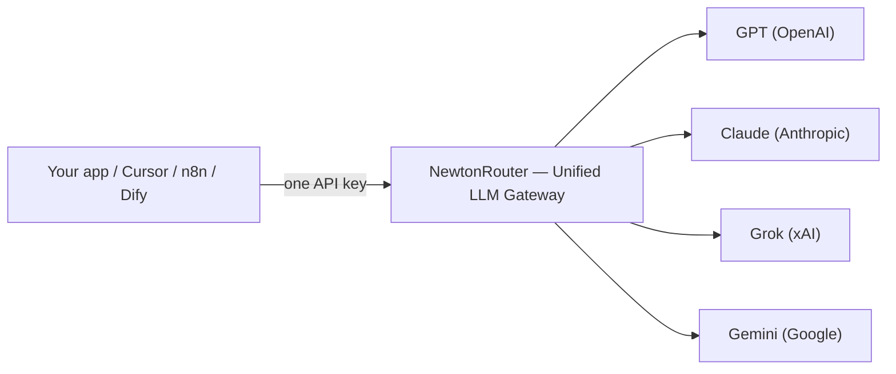

<!-- JSON-LD: Article + BreadcrumbList + FAQPage -->
<script type="application/ld+json">
{
  "@context": "https://schema.org",
  "@graph": [
    {
      "@type": "Article",
      "headline": "OpenRouter 替代品 2026：10+ 款大模型网关横评",
      "description": "Stripe 于 2026 年收购 OpenRouter。横评 10+ 款 OpenRouter 替代品，从价格、零留存、多语言到大模型网关稳定性，帮你便宜且不掉坑地迁移。",
      "author": { "@type": "Organization", "name": "NewtonRouter Team" },
      "publisher": {
        "@type": "Organization",
        "name": "NewtonRouter",
        "logo": { "@type": "ImageObject", "url": "https://newtonrouter.com/logo.png" }
      },
      "datePublished": "2026-11-10",
      "dateModified": "2026-11-10",
      "mainEntityOfPage": { "@type": "WebPage", "@id": "https://newtonrouter.com/zh/blog/openrouter-alternatives" }
    },
    {
      "@type": "BreadcrumbList",
      "itemListElement": [
        { "@type": "ListItem", "position": 1, "name": "博客", "item": "https://newtonrouter.com/zh/blog" },
        { "@type": "ListItem", "position": 2, "name": "OpenRouter 替代品", "item": "https://newtonrouter.com/zh/blog/openrouter-alternatives" }
      ]
    },
    {
      "@type": "FAQPage",
      "mainEntity": [
        {
          "@type": "Question",
          "name": "最便宜的 OpenRouter 替代品是什么？",
          "acceptedAnswer": {
            "@type": "Answer",
            "text": "直连供应商在技术上最便宜，完全没有平台费。在网关里，转售聚合器在很多模型上定价低于官方：APIVAI 声称省 56–86%，Crouter 宣传约官方 7.5 折，KissAPI 提供 5 倍充值额度。NewtonRouter 提供 $1 首充得 $5 额度及 7 语言界面。最大的节省通常来自为同一开源模型挑更便宜的供应商，而非仅仅免去一笔手续费。用你真实的提示去验证。"
          }
        },
        {
          "@type": "Question",
          "name": "OpenRouter 会在 token 价格上加价吗？",
          "acceptedAnswer": {
            "@type": "Answer",
            "text": "不会。OpenRouter 对 token 价格不加价，其每 token 费率与各供应商标价一致。它从信用卡充值收 5.5%（Standard 档）手续费（加密货币 5%，最低 $0.80），并对超出每月 $25,000 免费额度的自带 Key 流量收 5%。因此同样用量下，直连至少便宜 5.5%，还没算任何聚合折扣。"
          }
        },
        {
          "@type": "Question",
          "name": "从 OpenRouter 迁出很难吗？",
          "acceptedAnswer": {
            "@type": "Answer",
            "text": "通常几分钟。这里每个选项都暴露 OpenAI 兼容端点，所以改动就是换 base URL 与 API Key，偶尔加一个模型名前缀。真正的活儿是重建供应商偏好、支出上限与故障转移规则，不是代码改动。"
          }
        },
        {
          "@type": "Question",
          "name": "哪款 OpenRouter 替代品支持最多语言？",
          "acceptedAnswer": {
            "@type": "Answer",
            "text": "NewtonRouter 以 7 语言界面领先：简体中文、繁体中文、英语、法语、日语、俄语、越南语。APIVAI 提供 5 种（英语、俄语、中文、西班牙语、葡萄牙语）。其他多数网关只有英语。"
          }
        },
        {
          "@type": "Question",
          "name": "最适合隐私与零留存的 OpenRouter 替代品是哪款？",
          "acceptedAnswer": {
            "@type": "Answer",
            "text": "找明确的零留存架构与区域控制。OpenRouter 提供 ZDR 路由与 EU 锁定，但无 HIPAA。Requesty 允许你固定零留存端点并 EU 驻留。NewtonRouter 把零留存建进核心日志：提示词与补全都不存储。对最严苛的姿态，自托管选项如 LiteLLM 让所有流量留在你自己的网络内。"
          }
        },
        {
          "@type": "Question",
          "name": "有开源的 OpenRouter 替代品吗？",
          "acceptedAnswer": {
            "@type": "Answer",
            "text": "有。LiteLLM 采用最广，是一个免费开源、对接 100+ 供应商的 Python 代理。如果你已跑那些栈，Bifrost（Go）与 Kong AI Gateway 是备选。自托管去掉了平台费，却增加了运维所有权：数据库、打补丁与可用性。"
          }
        }
      ]
    }
  ]
}
</script>

# OpenRouter 替代品 2026：10+ 款大模型网关横评（含真实价格对比）

*由 NewtonRouter Team 发布 · 2026 年 11 月 10 日 · 最后核验 2026 年 11 月 10 日*

2026 年 8 月 19 日，[Stripe 宣布将收购 OpenRouter](https://stripe.com/jp/newsroom/news/stripe-agrees-to-acquire-openrouter)——这家为超过 1000 万开发者路由 600+ AI 模型的网关。如果你正在搜索 **OpenRouter 替代品**，你并不孤单。这笔交易引发了又一轮"OpenRouter 迁移"的搜索潮，团队们重新检视自己的 AI 流量、密钥与账单究竟落在何处。

但迁移焦虑只是故事的一半。过去一年多里，开发者们一直在抱怨一种任何仪表盘都看不出来的故障：**模型静默降级**。一个打标为旗舰模型的请求，被悄悄换成更便宜的替身，回答质量下滑，却没人能证明它发生过。这道信任缺口，才是许多团队真正出门寻找 OpenRouter 替代方案的原因。

本指南把 10+ 款网关并排横评，让你基于证据而非恐惧做选择。我们会讲清「大模型网关」到底做什么、决定你是否需要它的五个问题、一组完整的对比表，以及如何几分钟完成迁移。便宜且不掉坑，是我们贯穿全篇的挑选标准：价格低，但不能以偷偷降级或留存你的数据为代价。

> **关键要点**
> - 「大模型网关」（LLM 网关）把多家供应商的 SDK、密钥和账单收敛到一个 OpenAI 兼容接口。多数迁移只是换一个 base URL。
> - OpenRouter 仍是品类冠军（600+ 模型、80+ 供应商），但信用卡充值在 Standard 档收取 [5.5% 手续费](https://openrouter.ai/pricing)，且不提供自托管与 HIPAA 覆盖。
> - 最强的 **OpenRouter 替代品** 分为两派：开源自托管（LiteLLM）与托管聚合（NewtonRouter、Requesty、NanoGPT、Crouter、KissAPI、APIVAI、Atlas）。
> - 稳定性、隐私与价格是新战场：看是否「不降级」路由、零留存日志，以及在成本是首要考量时明显低于官方定价的费率。
> - **NewtonRouter 三者皆备**：7 种语言界面、零留存架构，且不静默降级。值得与老牌产品对比一番。

### 本文目录
- [什么是大模型网关？](#什么是大模型网关)
- [你真的需要网关吗？](#你真的需要网关吗)
- [2026 年 10+ 款最佳 OpenRouter 替代品](#2026-年-10-款最佳-openrouter-替代品)
- [如何选对适合你的 OpenRouter 替代品](#如何选对适合你的-openrouter-替代品)
- [迁移与上手：只是换个 base URL](#迁移与上手只是换个-base-url)
- [三个故事，解释这场迁移潮](#三个故事解释这场迁移潮)
- [需要警惕的危险信号](#需要警惕的危险信号)
- [常见问题](#常见问题)
- [结语：用证据选择，几分钟完成迁移](#结语用证据选择几分钟完成迁移)

## 什么是大模型网关？

如果你在权衡一款 OpenRouter 替代品，从这里开始。大模型网关是一层代理，位于你的应用与你所用的每一个模型供应商之间。你不用再为 OpenAI、Anthropic、Google 和 xAI 分别接线客户端、密钥、限流与计费，你的代码只跟一个 API 对话。你按名字选模型，网关在幕后把请求翻译成正确的供应商调用。

把它想成 AI 的万能适配器。接口几乎总是 [OpenAI 兼容](https://newtonrouter.com/blog/openai-compatible-api-explained) 的——这比任何标题里的模型数量都重要。如果你的现有代码已经用了 OpenAI SDK，改动两行（`base_url` 和 `api_key`），GPT、Claude、Gemini、Grok 就都能通过一个 Key 回答你。

一个成熟的**统一大模型 API**网关做四件事：

- **统一 API 接入。** 一个 Key、一种请求形态、数百个模型。从 `gpt-5` 切到 `claude-opus` 只需改一个字符串。
- **故障转移与路由。** 供应商超时或报错时，流量自动切到备用模型。优秀的网关会记录究竟是哪个模型实际完成了请求。
- **成本追踪。** 按 Key、按团队、按客户的支出归因，在一个仪表盘里完成，而不是在五个供应商后台里对账。
- **可观测性。** 延迟、token 数、成功率和故障转移事件，统一记录。

最好的 OpenRouter 替代品会保持这套接口完全一致，于是你的 SDK、你的 Cursor 配置、你的 n8n 工作流，永远察觉不到后端换了。



## 你真的需要网关吗？

不是每个项目都该多加一跳。你一旦越过几个阈值，网关就物有所值。

如果你使用超过一家模型供应商、需要自动故障转移、想要一张合并账单、处理受监管或敏感数据，或者运行智能体与自动化，你就需要一个**大模型网关**。对其中两项以上答"是"，网关就回本了。

问自己五个问题：

1. **你是否用了超过一家供应商？** 如果只用 OpenAI，直连更简单更快。可一旦为冗余或成本加入第二个模型，网关就开始回本。
2. **你需要自动故障转移吗？** 如果供应商宕机今天就能拖垮你的应用，网关的备用链路是你买得起的最便宜保险。
3. **你想要一张账单而不是五张？** 财务团队讨厌对账分开的供应商后台。网关能合并支出。
4. **你处理敏感或受监管数据吗？** 那你需要一个支持零留存路由与区域锁定的网关（或自托管代理）。
5. **你运行智能体或自动化吗？** 智能体循环会紧绷地烧 token。按 Key 的预算与路由策略，能阻止失控循环变成意外账单。

如果你对两项以上答"是"，网关值得上。如果你在单一模型上低量原型开发，保持直连，一个季度后再看。

在比较供应商之前，**[查看按 token 计费的价格 →](https://newtonrouter.com/pricing)** 了解每个套餐的覆盖内容。

想深入了解，可[对比 OpenRouter 替代品](llm-api-pricing-comparison-2026.md) 在各个模型与供应商间的表现。

## 2026 年 10+ 款最佳 OpenRouter 替代品

下面是正面硬刚。为了让手机上每一列都读得清，我们把对比拆成两张窄表，不需要横向拖动。排名依据真正影响日常体验的维度：价格、模型广度、稳定性、隐私与语言支持。*最后核验：2026-11-10。*

### 一眼看懂：价格、覆盖与适用场景

| 网关 | 计费模式 | 模型覆盖 | 最适合 |
|---|---|---|---|
| **OpenRouter** | Standard 档充值收 5.5% 手续费；按供应商标价透传 | 600+ / 80+ | 目录最全，零运维 |
| **NewtonRouter** | 首次充值：$1 换 $5 额度 | GPT / Claude / Grok / Gemini | 多语言、稳定、隐私、低成本 |
| **[LiteLLM](https://github.com/BerriAI/litellm)** | 开源免费；企业版付费 | 100+ 供应商 | 自托管，最大化控制 |
| **Portkey** | $49/月起 + 每 10 万日志 $9 | 1600+ / 250+ | 合规、企业治理 |
| **Requesty** | 模型成本加价 5%（自带 Key 0%） | 600+ / 30+ | 生产环境、EU 数据主权 |
| **Crouter** | 按 token，约官方 7.5 折，无免费档 | Claude / GPT / Gemini | 编程智能体 |
| **NanoGPT** | 文本无加价；$12/月 PRO | 634 文本 + 多模态 | 多模态、匿名使用 |
| **APIVAI** | 按量；约 5.6–8.6 折；最低 $10 | 20（12 Claude、8 GPT） | 成本导向的 Claude/GPT |
| **KissAPI** | 5 倍充值额度（$5→$25 起）；$1 免费试用 | Claude、GPT-5、Gemini | 全球开发者，无需 VPN |
| **Atlas** | 聚合、刷卡；多模态为主 | 图像 / 视频为主 | 多模态媒体 |

### 技术细节：稳定性、隐私与部署

| 网关 | 部署方式 | 稳定性 / 不降级 | 隐私 / 留存 |
|---|---|---|---|
| **OpenRouter** | 托管 | 故障转移至下一模型 | SOC 2、GDPR、ZDR 路由、EU 锁定；无 HIPAA / 本地部署 |
| **NewtonRouter** | 托管 | 一线渠道，不静默降级 | 零留存 |
| **LiteLLM** | 自托管（开源） | 自己掌控 | 自己掌控 |
| **Portkey** | 托管 + 开源核心（MIT） | 治理、护栏 | HIPAA、SOC 2、ISO 27001、PII 脱敏 |
| **Requesty** | 托管 | 20ms 内故障转移 | ZDR 可固定、EU 驻留、SOC 2 Type I |
| **Crouter** | 托管 | 跨渠道自动故障转移 | 未强调 |
| **NanoGPT** | 托管 | 自动路由、故障转移 | 账户可选，本地历史 |
| **APIVAI** | 托管 | 多渠道 | 不记录 body |
| **KissAPI** | 托管 | 多渠道故障转移；99.5% 可用率 | 未强调 |
| **Atlas** | 托管 | 未强调 | 未强调 |

**兼容性与界面语言。** 以上两张表中的所有网关都提供 OpenAI 兼容接口，通常只需替换 base URL。Crouter、NanoGPT、APIVAI 还同时支持 Anthropic 原生格式，NanoGPT 另支持 Responses API。控制台语言方面，只有 NewtonRouter（7 种）与 APIVAI（5 种）提供多语言界面，其余均为英文界面，Atlas 未说明。

### OpenRouter — 老牌 incumbent，公平评判

OpenRouter 配得上它的品类领先地位。一个 Key 触达 80+ 供应商的 600+ 模型，零基础设施要管，模型降级时自动故障转移。推理按各供应商标价透传。[OpenRouter](https://openrouter.ai/pricing) 的收入来自你充值时的 5.5%（Standard 档）手续费（加密货币 5%，最低 $0.80），以及对超出每月免费额度的自带 Key 流量再收 5%。它符合 SOC 2、兼容 GDPR，并提供零数据留存路由与 EU 区域锁定。

这些权衡是结构性的，不是道德问题。它不提供[自托管选项](https://newtonrouter.com/blog/self-hosted-vs-managed)（对某些人来说是合规障碍）、没有 HIPAA 覆盖，而 5.5%（Standard 档）手续费在规模化后是真金白银。如果你在原型阶段，它难逢对手。如果你需要 VPC 内部署、生产治理，或者单纯看不惯那笔手续费，下面的替代品就开始有意思了。

### 为什么考虑 NewtonRouter

NewtonRouter 是一个托管的、OpenAI 兼容的**大模型网关**，建立在一个承诺之上：你点名的模型，就是回答你的那个。把任意 OpenAI 兼容客户端指向 `https://newtonrouter.com/v1`，用一个 Key：ChatGPT 级应用、Cursor、Claude Code、Cline、n8n、Dify、LangChain，或你自己的机器人。它随即通过一个统一接口触达 GPT、Claude、Grok 与 Gemini。完整的[模型目录](https://newtonrouter.com/models)列出每一个模型及其实时费率。

它站得住脚的差异点：

- **不乱换模型。** 不少转售商承诺更大折扣，却悄悄用更便宜的模型替换来压价。NewtonRouter 的一线渠道意味着你拿到的是你点名的模型。它的定价来自与供应商的批量议价，而非在质量上偷工减料。
- **不降级。** 流量走一线渠道。有些聚合商会悄悄换成更便宜的模型，却仍按旗舰计费——至少他们的客户是这么指控的。NewtonRouter 不这么干。要 Claude，给你就是 Claude。
- **零留存。** 它既不存储你的提示词，也不存储你的补全结果。在托管网关里这很少见，对医疗、金融和 HR 工作负载却至关重要。看看[零留存日志](https://newtonrouter.com/docs)是怎么工作的。
- **7 种语言。** 简体中文、繁体中文、英语、法语、日语、俄语、越南语——这一覆盖没有任何主要竞品能比。
- **一切可见。** 实时定价、分组可用性与历史成功率都摆在仪表盘里，于是可用率与成本永远不会"黑屏"。

它不是目录最全的，那些折扣数字也是自报、未经审计的。但如果你想要前沿模型、你的团队用不止一种语言工作，或者你处理着漏不起的数据，它理应出现在你的清单上。

**想亲自验证差别？[首次充值付 $1，到账 $5 额度 →](https://newtonrouter.com/register)** 把一个客户端指向网关即可。一块钱的门槛、$5 的额度，规则摆在明面上：便宜且不掉坑，无需重写代码。

### LiteLLM — 开源标准

[LiteLLM](https://github.com/BerriAI/litellm) 是采用最广的自托管选项：一个 Python 代理与 SDK，通过一个 OpenAI 形态的接口对接 100+ 供应商。它免费开源，已在 Netflix、Lemonade 等公司的生产环境使用。代价是 ownership：你要跑 Postgres 和 Redis、打补丁、扛运维负担。如果你有平台工程师，且有硬性自托管要求，它是显而易见的选择；如果没有，托管选项能卸下这堆苦活。

### Portkey — 治理优先，现已并入 Palo Alto Networks

Portkey 围绕合规买家构建其网关：追踪、护栏、预算与策略控制，覆盖 HIPAA、SOC 2 与 ISO 27001。Palo Alto Networks 于 2026 年 5 月收购它，并入 Prisma AIRS。定价从 $49/月起，外加每 10 万日志 $9。其开源核心（Gateway 2.0）采用 MIT 许可，但日志持久化与合规报告仍把你引向云产品。如果安全是你的首要采购驱动，选它。

### Requesty — 带 EU 主权的生产路由

Requesty 在 30+ 供应商间路由 600+ 模型，统一加价 5%（自带 Key 0%）。其故障转移在 20ms 内完成，提供法兰克福的 EU 数据驻留，并允许你固定零留存端点。SOC 2 Type I、为 Cursor 与 Cline 提供原生 OAuth、且无按席位收费，使它成为需要区域控制又不想自建栈的团队的强力 **OpenRouter 替代品**。

### Crouter、NanoGPT、APIVAI、KissAPI、Atlas — 转售聚合层

这些网关在价格与便利上竞争，而非目录广度。如果你主要寻找便宜的 Claude/GPT API，这一层转售聚合器是重点考察对象：

- **Crouter** 把 Claude、GPT 与 Gemini 放在一个兼容 OpenAI 与 Anthropic 的端点后，带按 Key 的支出上限与自动故障转移。它宣传约官方 7.5 折（厂商自报），无免费档。
- **NanoGPT** 文本按标价计费、无加价、无押金，外加 $12/月的 PRO 档，也覆盖图像、视频与音频。账户可选，历史留在你的浏览器里。
- **APIVAI** 聚焦 Claude 与 GPT（20 个模型），同时支持 OpenAI 与 Anthropic 格式，声称相较官方定价省 56–86%，并提供一个 5 语言界面，无需 KYC。
- **KissAPI** 提供 5 倍充值额度（从 $5 到 $25 起）、免费 $1 试用，以及 Claude/GPT/Gemini 访问，99.5% 可用率，无需 VPN。
- **Atlas** 偏多模态，把 Grok Imagine、Kling、Vidu 这类图像与视频模型聚合到一个 OpenAI 兼容 Key 后。

上面的折扣数字都是自报，且取决于模型与档位。在投入生产流量前，用你真实的负载去验证。

## 如何选对适合你的 OpenRouter 替代品

没有唯一最好的 OpenRouter 替代品。对的那个取决于你是谁。让独立黑客如鱼得水的网关，可能拖垮高流量创业公司，反之亦然。把工具匹配到你是谁、你跑什么，然后在真实流量上验证。

选网关是一个维度，[每个任务该用哪个模型](llm-model-selection-2026.md) 是另一个：我们的选型指南把工作负载映射到入门、中档、旗舰三档，再谈预算。

### 如果你是独立开发者

你想要最低摩擦与最低门槛。**NanoGPT**（起价 $0.10，无需账户）或 **KissAPI**（免费 $1 试用、5 倍额度）让你无需承诺就能试验。**NewtonRouter** 适合你看重稳定性与清爽的多语言仪表盘。跳过自托管，你的时间更该用来构建。

### 如果你是创业团队

你需要整合与成本管控。一个带按 Key 预算的托管聚合器，能防止某个失控功能吃掉融资跑道。**Requesty** 与 **NewtonRouter** 都提供策略控制与透明定价。如果你已经在 Kong 或 Kubernetes 上标准化，扩展已有方案，而不是新增一个供应商。

### 如果你构建智能体或自动化

智能体循环正是网关赚回手续费的地方。你需要按 Key 的支出上限、快速故障转移与请求级日志。**NewtonRouter**、**Requesty** 与 **Portkey** 都在调用前而非账单后强制预算。挑那个能用日志告诉你：哪个智能体、哪个客户、哪个模型，花掉了每一美元。

### 如果控制成本就是全部意义

直连供应商在技术上最便宜，但你会失去统一 API。次优解是转售聚合器：**APIVAI**、**Crouter** 或 **KissAPI** 都在很多模型上定价低于官方。在你最常用的 10 条提示上比有效费率，而不是比首页卡片。

不确定[哪些网关真正值得纳入](llm-api-pricing-comparison-2026.md)？我们的拆解按模型逐条对比有效费率。

当你收窄了候选范围，**[查看套餐 →](https://newtonrouter.com/plans)** 在迁移前了解可用选项。

## 迁移与上手：只是换个 base URL

这是让新手惊讶的部分。从 OpenRouter（或任意网关）迁到一款 OpenRouter 替代品，通常只需几分钟。本清单里的每个选项都暴露一个 OpenAI 兼容端点。改动就是换 base URL 与 API Key，偶尔再加一个模型名前缀。

对 OpenAI SDK：

```python
from openai import OpenAI

client = OpenAI(
    base_url="https://newtonrouter.com/v1",  # 原来是 api.openai.com/v1 或 openrouter.ai/api/v1
    api_key="your-gateway-key",
)
resp = client.chat.completions.create(
    model="claude-opus",  # 或 gpt-5、gemini-pro、grok，随你选
    messages=[{"role": "user", "content": "总结这条部署日志。"}],
)
```

对 AI 编程工具，就是环境变量。把 [Cursor](https://newtonrouter.com/blog/point-cursor-at-unified-api) 或 Claude Code 指向新的 base URL 与 Key，每一个模型、每一次工具调用、每一轮智能体运行，都走网关，零代码改动。**n8n**、**Dify**、**LangChain** 与 **Cline** 遵循同一模式：设好 base URL，设好 Key，完事。

从仪表盘拿到凭证：先[注册](https://newtonrouter.com/register)，再创建 API Key——创建 Key 本身不收费。额度是另一步：首次充值付 $1，账户到账 $5 额度。然后用这个 Key 把任意客户端指向网关。代码侧仍然只是换一个 base URL。

真正的活儿不是改代码。而是重建你的供应商偏好、支出上限与故障转移规则——不是代码改动。先从当前配置里导出这些。一个实际褶皱：有些网关会给模型名加命名空间（比如 `anthropic/claude-opus` 而非裸 `claude-opus`）。在你的配置里做一次快速查找替换，再跑几条真实调用，确认流式、工具调用与结构化输出在翻生产流量前表现正常。

> **迷你故事：五个 SDK 变成一个 Key。** 2026 年 3 月，一家两人创业公司"Northwind Analytics"上线了一条文档流水线，手工接了四家供应商：OpenAI 做摘要、Anthropic 做长上下文、Google 做视觉、一个自托管模型做廉价分类。客户 deadline 到来时，他们的主程 Priya 一周里花了 11 个小时，只因一家供应商改了 schema，她就忙着对齐四个 SDK。她用一个午休，把四个服务全指向同一个网关 Key。下一次本该拖垮其中两个集成的供应商宕机，反而静默故障转移了。他们的月度集成维护从约 11 小时降到近乎零，Priya 也交付了那个促成签约的功能。

## 三个故事，解释这场迁移潮

故事比参数表更能留下印象。这里有三个，道出团队为何离开，又得到了什么。

> **迷你故事：没人能证明的静默降级。** Marcus 经营一家独立开发工具生意。连续六周，他发誓自己"GPT-5 级"的客服回复变弱了，可他的延迟与成本仪表盘看着都正常。他最终记录了原始响应，发现约 30% 被打标为高级的调用，其实是被一个更便宜的模型服务，没有报错、没有标记、没有退款。他没法向供应商证明，只能证明给自己。他迁到了一个会记录每次请求确切模型与供应商的网关。"我不需要最便宜的模型，"他说，"我需要我点名的那个。"切换后那个月，他的客户流失工单率降了 18%。

> **迷你故事：终于能睡整觉的团队。** 一家金融科技后端团队把生产流量走单一供应商，因一次区域性宕机丢了整个周六。迁到带自动故障转移与按 Key 预算的网关后，他们两个季度里 AI 事故的 on-call 呼叫量降到了零。网关的支出上限还截住了一个配错的智能体循环，否则它一夜之间就能跑出四位数账单。它在边界就快速失败，而不是事后。

## 需要警惕的危险信号

谁都能找到一款网关。但很少有人去查它六个月后是否还立得住。几个警示信号，把严肃的基础设施与精致的落地页区分开来，无论你是在比较 OpenRouter 这样的老牌，还是全新的聚合器。

**含糊的可用率，且没有记录的模型身份。** 如果一款网关无法告诉你哪次请求到底是哪个模型服务的，你就无法审计质量，也抓不到静默降级。坚持要按请求的模型与供应商元数据，而不只是一个绿色状态点。

**没有方法论的折扣。** 像"官方 7.5 折"或"低至标价 X 折"这类说法，不附上模型、档位与日期就毫无意义。最好的 OpenRouter 替代品发布实时费率卡，你随时可以对照供应商价格页核验。

我们的[OpenRouter 替代品汇总](llm-api-pricing-comparison-2026.md) 为每条费率标注了模型、档位与日期。

**没有明示的留存政策。** 如果一家供应商不肯清楚说明是否存储提示词或补全结果，对敏感数据就往最坏处想。零留存应该是一种有文档的架构，而不是首页上随便贴的营销形容词。

**把故障转移当卖点却从不测试。** 自动故障转移只有在真触发时才有用。问问网关是否模拟供应商宕机、每一次回退是否带延迟记录。你看不见的回退，是你没法信任的回退。

**区域与语言缺口。** 如果用户落在 EU，找 EU 驻留与签好的 DPA。如果团队遍布全球，一个 7 语言界面——NewtonRouter 交付的那种——能消除英语独占工具悄悄制造的真实支持摩擦。

这些检查花十分钟，却能避免六个月后痛苦的二次迁移。

## 常见问题

**最便宜的 OpenRouter 替代品是什么？**
直连供应商在技术上最便宜，完全没有平台费。在网关里，转售聚合器在很多模型上定价低于官方：APIVAI 声称省 56–86%，Crouter 宣传约官方 7.5 折，KissAPI 提供 5 倍充值额度。NewtonRouter 提供 $1 首充得 $5 额度及 7 语言界面。最大的节省通常来自为同一开源模型挑更便宜的供应商，而非仅仅免去一笔手续费。用你真实的提示去验证。

**OpenRouter 会在 token 价格上加价吗？**
不会。OpenRouter 对 token 价格不加价，其每 token 费率与各供应商标价一致。它从信用卡充值收 5.5%（Standard 档）手续费（加密货币 5%，最低 $0.80），并对超出每月 $25,000 免费额度的自带 Key 流量收 5%。因此同样用量下，直连至少便宜 5.5%，还没算任何聚合折扣。

**从 OpenRouter 迁出很难吗？**
通常几分钟。这里每个选项都暴露 OpenAI 兼容端点，所以改动就是换 base URL 与 API Key，偶尔加一个模型名前缀。真正的活儿是重建供应商偏好、支出上限与故障转移规则，不是代码改动。

**哪款 OpenRouter 替代品支持最多语言？**
NewtonRouter 以 7 语言界面领先：简体中文、繁体中文、英语、法语、日语、俄语、越南语。APIVAI 提供 5 种（英语、俄语、中文、西班牙语、葡萄牙语）。其他多数网关只有英语。

**最适合隐私与零留存的 OpenRouter 替代品是哪款？**
找明确的零留存架构与区域控制。OpenRouter 提供 ZDR 路由与 EU 锁定，但无 HIPAA。Requesty 允许你固定零留存端点并 EU 驻留。NewtonRouter 把零留存建进核心日志：提示词与补全都不存储。对最严苛的姿态，自托管选项如 LiteLLM 让所有流量留在你自己的网络内。

**有开源的 OpenRouter 替代品吗？**
有。LiteLLM 采用最广，是一个免费开源、对接 100+ 供应商的 Python 代理。如果你已跑那些栈，Bifrost（Go）与 Kong AI Gateway 是备选。自托管去掉了平台费，却增加了运维所有权：数据库、打补丁与可用性。

## 结语：用证据选择，几分钟完成迁移

OpenRouter 配得上它的领先，Stripe 的交易也改变不了这点。但"市场领先"与"适合你"是两码事。如果你需要自托管、EU 主权、零留存、多语言支持，或者单纯拒绝在规模化后付那 5.5%（Standard 档）手续费，2026 年的 **OpenRouter 替代品** 阵容比以往更深、更强。

先从回答上面的五个问题开始。然后把你的常用 10 条真实提示，跑过两三家入围网关，记录输入 token、输出 token、延迟与成本，和当前配置对比。迁移本身只是换一个 base URL。思考才是真正的活儿。

如果你想要前沿模型、不降级、零留存、还在一个 7 语言仪表盘上，**[付 $1，得 $5 额度 →](https://newtonrouter.com/register)**。把一个客户端指向 `https://newtonrouter.com/v1`，保留你现有的 SDK，看看一个透明网关能带来什么不同。你未来的 on-call 版本会感谢你。
