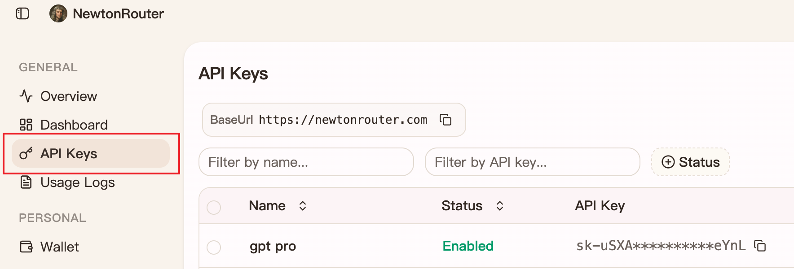
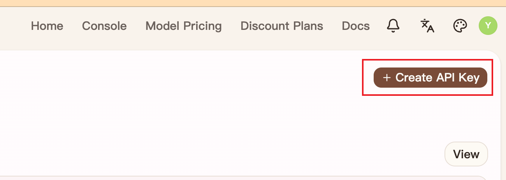
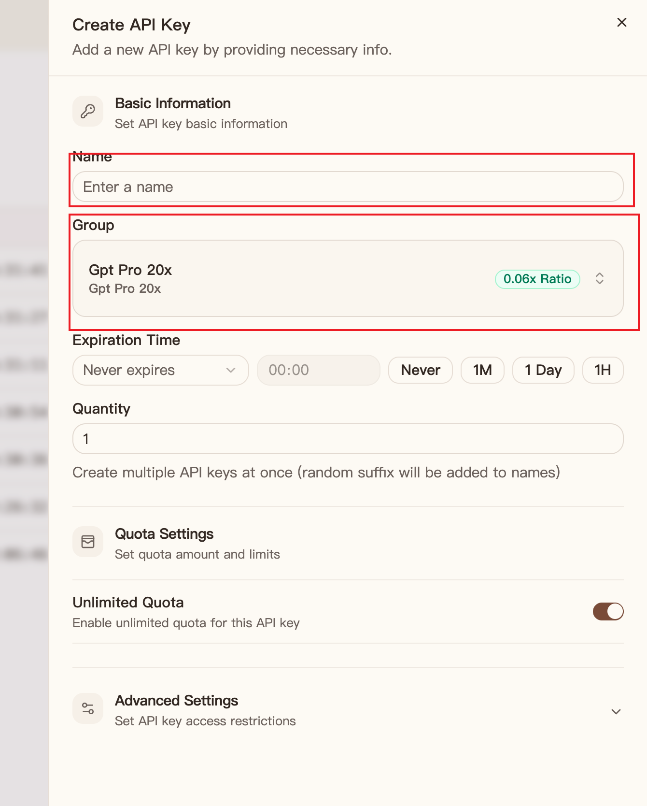

# Quick Start

Before using Newton AI Router, create an account, add funds or subscribe to a plan, and create an API key.

## Create an account

1. Visit [Newton AI Router](https://newtonrouter.com/).
2. Enter the verification code sent to your email to complete registration.

## Add funds or subscribe

1. Open the **Console**.
2. Select **Wallet** in the sidebar.
3. Enter an amount to add funds, or choose a subscription plan.

!!! tip "Trial plan"
    A trial plan is currently available: pay CNY 0.01 to receive CNY 2 in credit. Limited to one purchase per person.

## Create an API key

1. Open the **Console**.
2. Select **API Keys** in the sidebar.

3. Select **Create API Key** in the upper-right corner.

4. Enter a name for the key.
5. Select the group you want to use.
6. Set the usage limit and save the key.

